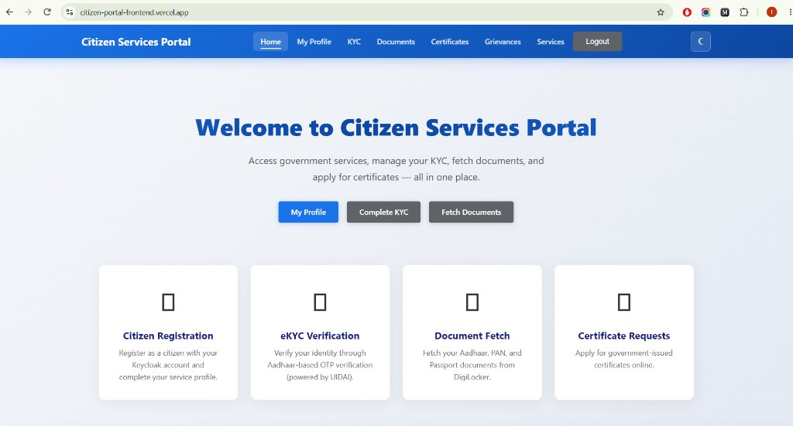
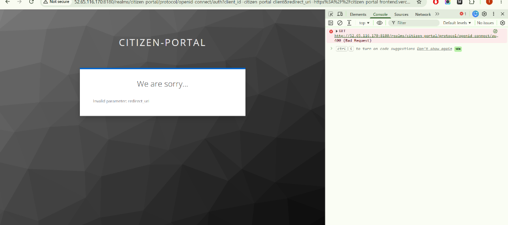
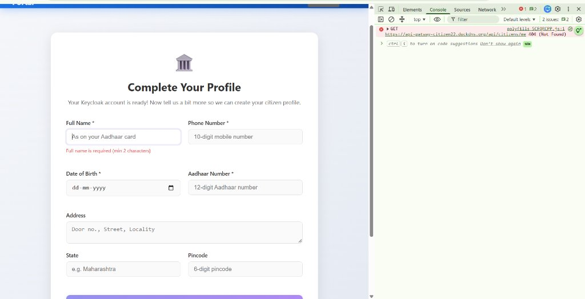
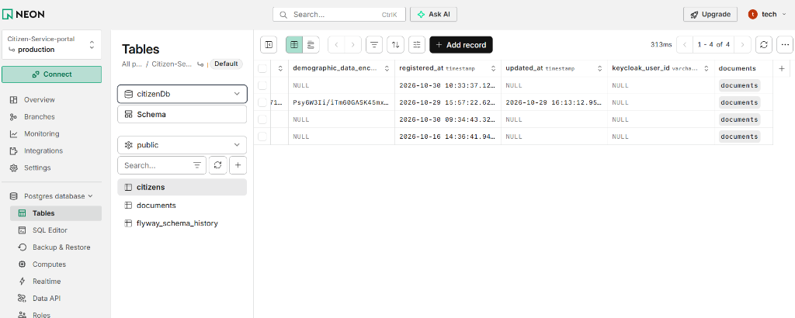
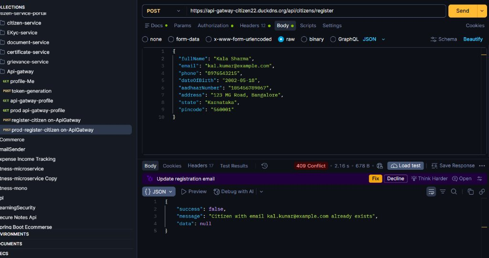

# Citizen Services Portal — Microservice Architecture

[](https://citizen-portal-frontend.vercel.app/)
[](https://api-gatway-citizen22.duckdns.org)
[](https://citizen-keyclock22.duckdns.org)
[](https://neon.tech)

A Spring Boot microservices project simulating a government citizen-services portal. Citizens register, complete Aadhaar-based KYC, fetch documents, request certificates, and file grievances — all through an Angular frontend backed by event-driven microservices communicating via Apache Kafka.

---

## 🌐 Live Production Deployment

| Component | Platform / Host | Production URL |
|---|---|---|
| **Frontend Portal** | Vercel | [https://citizen-portal-frontend.vercel.app](https://citizen-portal-frontend.vercel.app) |
| **API Gateway** | AWS EC2 (Nginx + SSL) | `https://api-gatway-citizexxxxxxxx.org` |
| **Identity & Access (IAM)** | AWS EC2 (Keycloak 24) | `https://citizen-keycloccccxxx.org` |
| **Databases** | Neon Serverless PostgreSQL | Cloud Hosted (`keycloakdxx`, `citizenxxxxxb`) |

---

## 📸 Application Demo & Screenshots

### 1. Citizen Portal Home & Dashboard
> Fully deployed responsive Angular 19 frontend hosted on Vercel with clean navigation for Services, KYC, Documents, Certificates, and Grievances.



---

### 2. Single Sign-On (Keycloak IAM)
> Secure authentication powered by Keycloak 24 running on AWS EC2 with Let's Encrypt SSL. Issues JWT Bearer tokens to the Angular client.



---

### 3. Citizen Onboarding & Profile Completion
> Once authenticated via Keycloak, new citizens complete their profile details (linked to their unique Keycloak `sub` claim via `POST /api/citizens/me/onboarding`).



---

### 4. Cloud Database Management (Neon PostgreSQL)
> Serverless PostgreSQL on Neon storing isolated database tables per microservice (`citizens`, `documents`, `kycSessionDb`, etc.) with Keycloak user ID relationships.



---

### 5. API Gateway & Microservices Testing (Postman)
> End-to-end API testing through the production API Gateway with automated Keycloak Bearer token authentication and routing.



---

## Architecture

```
                      ┌──────────────────────────────────────────────┐
                      │  Angular 19 Frontend (Vercel)                │
                      │  https://citizen-portal-frontend.vercel.app  │
                      └──────────────┬───────────────────────────────┘
                                     │
           ┌─────────────────────────┴─────────────────────────┐
           │ (HTTPS Login Redirect / JWT Bearer)                │ (HTTPS API Requests + JWT)
           ▼                                                   ▼
┌──────────────────────────────────────┐    ┌──────────────────────────────────────────────┐
│  AWS EC2 — Keycloak 24 Auth Server   │    │  AWS EC2 — API Gateway (Nginx SSL Term.)    │
│  https://citizen-xxxxxxxxxxxxxxxxxx  │    │  https://api-gatway-citizenxxxxxxxx   │
├──────────────────────────────────────┤    └──────────────────────┬───────────────────────┘
│ Nginx (Port 443 with Let's Encrypt)  │                           │
│   ↓                                  │             ┌─────────────┼─────────────┐
│ Keycloak Container (Port 8180)       │             ▼             ▼             ▼
│   ↓                                  │     citizen-service  ekyc-service  document-service
│ Neon DB: keycloakdb2                 │         (:8081)        (:8082)         (:8083)
└──────────────────────────────────────┘             │             │             │
                                                     ▼             ▼             ▼
                                             certificate-svc  grievance-svc  notification-svc
                                                 (:8084)        (:8085)         (:8087)
                                                           │
                                                           └──► Eureka Server (:8761)
Kafka Event Flow:
  citizen-service  ──kyc.initiation.event──────────► ekyc-service
  ekyc-service     ──kyc.verification.completed──────► citizen-service, notification-service
  citizen-service  ──document.fetch.requested─────────► document-service
  citizen-service  ──certificate.issuance.requested──► certificate-service
  citizen-service  ──grievance.submitted───────────────► grievance-service, notification-service
```

---

## Services & Ports

| Service | Port | DB Port | Purpose |
|---|---:|---:|---|
| `eureka-server` | `8761` | — | Spring Cloud Eureka service registry |
| `api-gateway` | `8080` (443 SSL) | — | JWT validation, routing, CORS, Header enrichment |
| `citizen-service` | `8081` | Neon / `5433` | Registration, onboarding, KYC initiation, documents |
| `ekyc-service` | `8082` | Neon / `5437` | OTP-based Aadhaar KYC, mock UIDAI integration |
| `document-service` | `8083` | Neon / `5434` | Async document fetch & storage |
| `certificate-service` | `8084` | Neon / `5435` | Async certificate issuance |
| `grievance-service` | `8085` | Neon / `5438` | Grievance submission & tracking |
| `notification-service` | `8087` | Neon / `5436` | Consumes events, sends email notifications |
| `frontend` | `4200` (Vercel) | — | Angular 19 citizen portal UI |
| **Keycloak** | `8180` (443 SSL) | Neon (`keycloakdb2`) | OpenID Connect / OAuth2 Identity Management |

---

## Tech Stack

| Area | Technology |
|---|---|
| Frontend | Angular 19.2, TypeScript 5.7, Keycloak-Angular, Tailwind CSS / Custom UI |
| Frontend Hosting | Vercel (Edge network, SPA HTML5 route rewrites) |
| Backend | Java 21, Spring Boot 3.4.5, Spring Cloud 2024.0.1 |
| Cloud Hosting | AWS EC2 (Ubuntu 22.04 LTS), Docker, Docker Compose |
| Networking / SSL | Nginx Reverse Proxy, DuckDNS, Let's Encrypt (Certbot Auto-Renewal) |
| Security | Keycloak 24.0.3, OAuth2 Resource Server, JWT with Role Converters |
| Messaging | Apache Kafka (Confluent 7.4.0), Zookeeper |
| Database | Neon Serverless PostgreSQL, Flyway Schema Migrations |
| Service Discovery | Netflix Eureka Server, Spring Cloud LoadBalancer |

---

## Production Setup & Deployment Details

### 1. Frontend on Vercel
- **Repository directory**: `frontend/`
- **Build command**: `npm run build:vercel`
- **Output directory**: `dist/citizen-portal/browser`
- **Dynamic Config**: `scripts/set-env.js` reads environment variables at build time and generates `src/environments/environment.prod.ts`.
- **SPA Rewrites**: Configured in `vercel.json` so Angular HTML5 routing works on page refreshes.

**Vercel Environment Variables:**
```env
KEYCLOAK_URL=https://citizen-keyclockxxxxxxx
KEYCLOAK_REALM=citizexxx
KEYCLOAK_CLIENT_ID=citizen-porxxxxx
API_GATEWAY_URL=https://api-gatway-citizenxxxxxx
```

### 2. Nginx SSL Reverse Proxy & CORS
Both Keycloak and API Gateway run on separate AWS EC2 instances with Nginx acting as the SSL termination proxy on port 443:
- Let's Encrypt certificates generated via `certbot --standalone` / `certbot --nginx`.
- Nginx on the API Gateway instance handles preflight `OPTIONS` requests and bypasses browser CORS restrictions cleanly.

### 3. Keycloak Production Configuration
Keycloak runs with `--proxy=edge` and `KC_HOSTNAME_URL=https://citizen-keyclockxxxx` so all issued JWT tokens and metadata have HTTPS URLs matching Spring Security's expectations.

---

## REST API Summary

All requests pass through the **API Gateway** (`https://api-gatway-citizenxxxx` in prod or `http://localhost:8080` locally) with a Keycloak Bearer token:

```http
Authorization: Bearer <keycloak_token>
```

### citizen-service — `/api/citizens`

| Method | Endpoint | Description |
|---|---|---|
| `GET` | `/me` | Get profile for authenticated user (derived from JWT `sub`) |
| `POST` | `/me/onboarding` | Complete onboarding for authenticated Keycloak user |
| `POST` | `/initiate-kyc` | Initiate Aadhaar KYC (publishes Kafka event) |
| `POST` | `/fetch-document` | Request document fetch (publishes Kafka event) |
| `POST` | `/{id}/request-certificate` | Request certificate issuance |
| `GET` | `/{id}/services` | List available government services |

### ekyc-service — `/api/kyc`

| Method | Endpoint | Description |
|---|---|---|
| `POST` | `/generate-otp` | Generate OTP for Aadhaar KYC |
| `POST` | `/verify-otp` | Verify OTP and complete KYC (mock test OTP: `123456`) |
| `GET` | `/{citizenId}/status` | Get KYC status for a citizen |
| `POST` | `/mock-uidai/otp/generate` | Mock UIDAI OTP generation endpoint |
| `POST` | `/mock-uidai/otp/verify` | Mock UIDAI OTP verify endpoint |

### document-service — `/api/documents`

| Method | Endpoint | Description |
|---|---|---|
| `GET` | `/{citizenId}/list` | List fetched documents for a citizen |

### certificate-service — `/api/certificates`

| Method | Endpoint | Description |
|---|---|---|
| `GET` | `/{id}` | Get certificate by ID |
| `GET` | `/citizen/{citizenId}` | List all certificates for a citizen |

### grievance-service — `/api/grievances`

| Method | Endpoint | Description |
|---|---|---|
| `POST` | `/` | Submit a new grievance |
| `GET` | `/citizen/{citizenId}` | List grievances for a citizen |
| `GET` | `/{id}` | Get grievance by ID |

---

## Getting Started (Local Development)

### Prerequisites

- Java 21+
- Node.js 20+ & npm
- Docker Desktop

### 1. Start Infrastructure

```bash
docker compose up -d
```
Starts Kafka, Keycloak, and local PostgreSQL databases.

### 2. Start Eureka Server

```bash
cd eureka-server
./mvnw spring-boot:run
```
Console at: `http://localhost:8761`

### 3. Start Backend Services
Start each service using its Maven wrapper (`mvnw spring-boot:run`):
- `citizen-service` (:8081)
- `ekyc-service` (:8082)
- `document-service` (:8083)
- `certificate-service` (:8084)
- `grievance-service` (:8085)
- `notification-service` (:8087)
- `api-gateway` (:8080)

### 4. Start Angular Frontend

```bash
cd frontend
npm install
npm start
```
Frontend runs at: `http://localhost:4200`

---

## Authors & Acknowledgments

- **Architecture**: Spring Boot Microservices + Angular 19 + Keycloak IAM
- **Cloud Infrastructure**: AWS EC2, Vercel, Neon PostgreSQL, Let's Encrypt, DuckDNS
